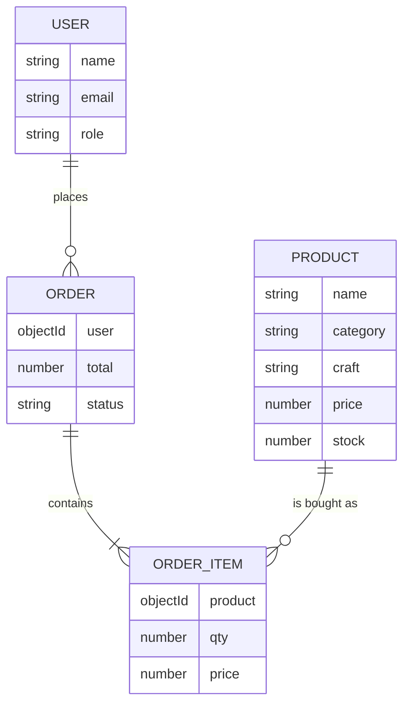

# Rang Haveli: Rajasthani Heritage E-Commerce Web Application

**Project type:** Final year project
**Stack:** MongoDB, Express.js, React.js, Node.js (MERN)

Name, enrolment number, guide, department and college: *(fill in before submission)*

---

## 1. Abstract
Rajasthan's artisans produce some of India's best-known textiles and jewellery, such as bandhani and leheriya sarees and lac and meenakari bangles. Most of these craftspeople sell through local markets and have little access to online customers. *Rang Haveli* is a full-stack web application that lets a Rajasthani shop sell its traditional products online. The main collections are sarees, bangles and earrings, and the shop also sells necklaces, dupattas, lehengas, juttis, potli bags and home decor. Customers can browse by craft, search, order and track purchases. The shop owner can manage products and orders through a dashboard. The system uses React for the interface, Node.js and Express for the REST API, and MongoDB for storage.

## 2. Introduction
Online shopping has grown quickly in India, but small traditional businesses often rely on marketplaces that charge high commissions and hide the story behind each product. This project builds a dedicated store whose design and content come from Rajasthani culture. The interface uses colours, shapes and craft names from the region.

## 3. Problem statement
- Traditional shops reach only customers who visit in person.
- General marketplaces give little room to explain a craft, its origin and its makers.
- Small owners need a simple way to manage stock and orders without technical skill.

## 4. Objectives
1. Build a responsive storefront for traditional Rajasthani products, mainly sarees, bangles and earrings, plus necklaces, dupattas, lehengas, juttis, potli bags and home decor.
2. Let customers search, filter, add to a bag and place orders securely.
3. Give the owner a dashboard for products, stock and order status.
4. Store all data in a database and expose it through a REST API.
5. Present Rajasthani craft heritage through the design and product information.

## 5. Scope
**In scope:** product catalogue of nine collections (sarees, bangles, earrings, necklaces, dupattas, lehengas, juttis, potli bags, home decor), search and filters, bag, user accounts, checkout (Cash on Delivery and UPI), order history, admin dashboard.
**Out of scope (future work):** online payment gateway, product photo upload, reviews, email or SMS notifications.

## 6. Existing vs proposed system
| Existing system | Proposed system |
|---|---|
| Sales only in the physical shop | Available online at any time |
| Stock tracked on paper | Stock updated automatically on each order |
| No record of customers or orders | Accounts and order history in a database |
| Craft story told only by the seller | Craft and origin shown on every product |

## 7. Technology used
| Part | Technology | Reason |
|---|---|---|
| Frontend | React 18, JSX, CSS, React Router | Component-based UI, fast page changes without reloads |
| Build tool | Vite | Quick development server |
| Backend | Node.js, Express.js | JavaScript on both sides, simple REST routing |
| Database | MongoDB, Mongoose | Flexible documents suit products with different attributes |
| Security | JWT, bcrypt | Stateless login, hashed passwords |

## 8. System requirements
- **Software:** Node.js 18 or newer, MongoDB, a modern browser, VS Code (or any editor)
- **Hardware:** any computer with 4 GB RAM or more

## 9. System architecture
```
 ┌────────────────────┐    HTTP / JSON     ┌──────────────────────┐   Mongoose   ┌───────────┐
 │  React frontend    │ ─────────────────► │  Express backend     │ ───────────► │ MongoDB   │
 │  (browser)         │ ◄───────────────── │  REST API + JWT auth │ ◄─────────── │ database  │
 └────────────────────┘                    └──────────────────────┘              └───────────┘
   pages, bag, forms                         routes, validation,                   users, products,
                                             stock and price checks                orders
```
In development, Vite forwards every `/api` request from port 5173 to the Express server on port 5000.

## 10. Modules
1. **Authentication:** register, log in, keep the session with a JWT token, role check (customer or admin).
2. **Catalogue:** list, search, filter by category and craft, sort by price, pagination.
3. **Product detail:** description, craft, origin, size selection for bangles, juttis and lehengas, stock status.
4. **Shopping bag:** add, change quantity, remove; saved in the browser; shipping rule.
5. **Orders:** address and payment choice; the server recalculates totals, reduces stock and saves the order.
6. **Admin dashboard:** statistics, product add/edit/delete, order status updates.

## 11. Database design
**users**
| Field | Type | Notes |
|---|---|---|
| name | String | required |
| email | String | unique |
| password | String | bcrypt hash, never returned by the API |
| role | String | `customer` or `admin` |

**products**
| Field | Type | Notes |
|---|---|---|
| name, slug | String | slug is unique and used in the URL |
| category | String | one of 9 collections: sarees, bangles, earrings, necklaces, dupattas, lehengas, juttis, potli-bags, home-decor |
| craft, origin | String | e.g. Bandhani, Jaipur |
| description, fabric, material | String | |
| price, mrp, stock | Number | |
| sizes | [String] | bangle, jutti or lehenga sizes; empty means one size |
| colors, pattern | [String], String | used to draw the product picture |
| featured | Boolean | shown on the home page |

**orders**
| Field | Type | Notes |
|---|---|---|
| user | ObjectId | reference to users |
| items | Array | product, name, price at purchase, qty, size |
| shipping | Object | name, phone, address, city, state, pincode |
| paymentMethod | String | `COD` or `UPI` |
| itemsTotal, shippingFee, total | Number | calculated by the server |
| status | String | placed, packed, shipped, delivered, cancelled |

**Entity relationship diagram**


## 12. Process flow: placing an order
1. The customer adds items to the bag (stored in the browser).
2. At checkout the customer logs in and enters the address.
3. The browser sends only product ids, quantities and sizes to `POST /api/orders`.
4. The server loads the real prices and stock from MongoDB, rejects the order if stock is short, reduces stock, and saves the order.
5. The customer sees the order in *Your orders*; the owner sees it in the dashboard and updates its status.

## 13. Security measures
- Passwords are hashed with bcrypt before storage.
- Protected routes require a valid JWT; admin routes also check the role.
- New accounts are always created as `customer`.
- Prices are never taken from the browser, so they cannot be edited by a customer.
- Search text is escaped before it is used in a database query.

## 14. Testing
| No. | Test case | Expected result | Result |
|---|---|---|---|
| 1 | Register with a new email | Account created, user logged in | |
| 2 | Register with an existing email | Error message shown | |
| 3 | Log in with a wrong password | Error message shown | |
| 4 | Filter products by "Bandhani" | Only bandhani products listed | |
| 4a | Open the Earrings collection | Only earrings listed | |
| 5 | Add a bangle or jutti without choosing a size | Message asks for a size | |
| 6 | Add more items than the stock | Quantity limited to the stock | |
| 7 | Open checkout while logged out | Redirected to the login page | |
| 8 | Place a valid order | Order saved, stock reduced, bag emptied | |
| 9 | Open `/admin` as a customer | Redirected to the home page | |
| 10 | Owner changes order status | Customer sees the new status | |

*(Run each case and fill in the Result column: Pass or Fail.)*

## 15. Screenshots
Save screenshots in `docs/screenshots/` and list them here: home page, shop page, product page, bag, checkout, orders, admin dashboard.

## 16. Limitations
- Payments are recorded but not processed online.
- Product pictures are drawings generated from colours and patterns, not photographs.
- Product sizes are fixed per collection.
- No email or SMS notifications.

## 17. Future scope
- Razorpay or other payment gateway
- Photo upload with cloud storage
- Product reviews and ratings, wishlist
- Order notifications by email and WhatsApp
- Hindi language option
- Mobile app using React Native

## 18. Conclusion
Rang Haveli shows how a traditional craft business can sell online with a modern full-stack application. It covers the complete cycle from browsing to delivery tracking, keeps data in a database, and presents Rajasthani heritage through its design.

## 19. References
- React documentation: https://react.dev
- Express documentation: https://expressjs.com
- MongoDB and Mongoose documentation: https://www.mongodb.com/docs, https://mongoosejs.com
- Node.js documentation: https://nodejs.org
- JSON Web Tokens: https://jwt.io
